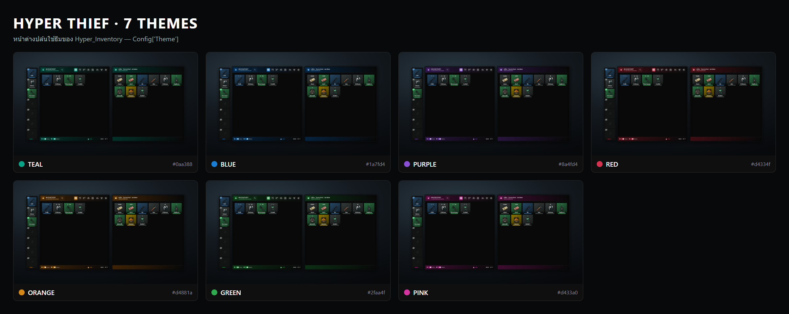
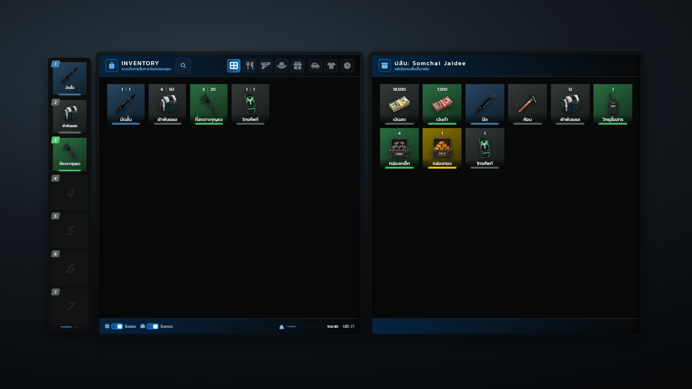
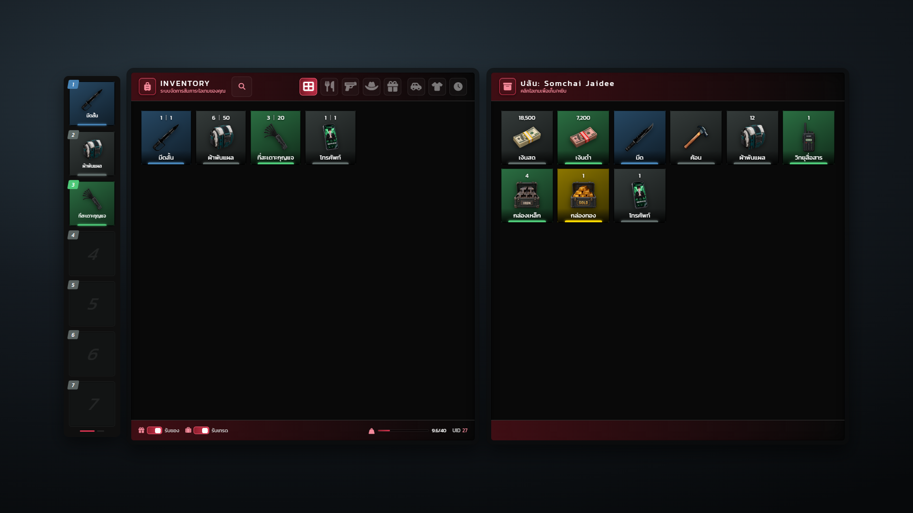
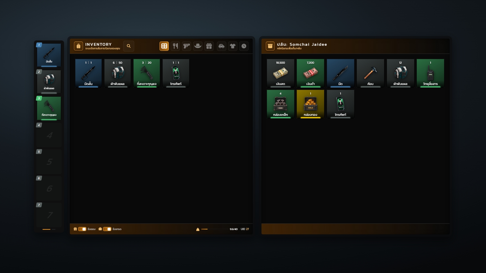
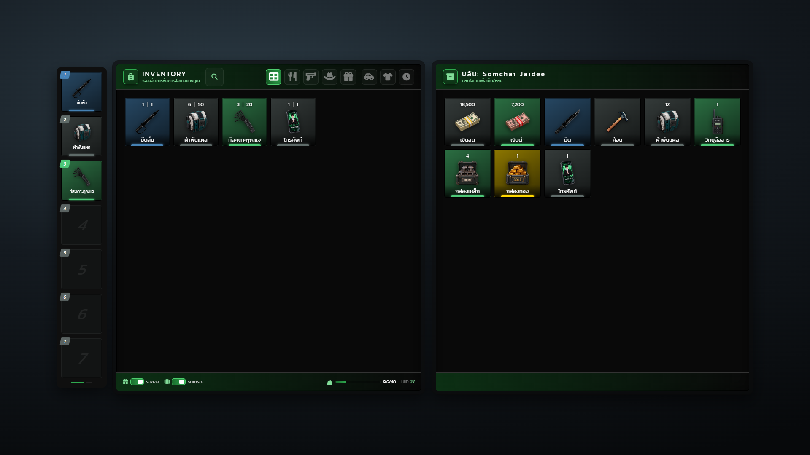
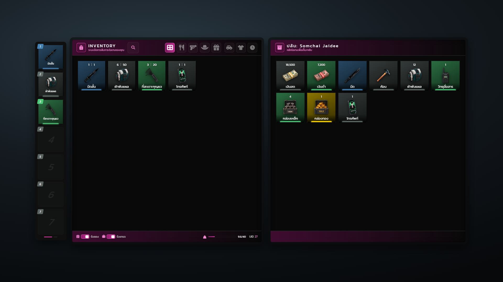

# ธีมสี

หน้าต่างปล้นใช้ธีมของ Hyper_Inventory มี 7 ธีม เปลี่ยนที่ `Config["Theme"]` บรรทัดเดียว (ค่าเริ่มต้น teal) Hyper_Thief ไม่มีธีมของตัวเอง

| ธีม | สีหลัก (primary) | สีสว่าง (primaryBr) | สีอ่อน (primaryLt) |
| --- | --- | --- | --- |
| teal (ค่าเริ่มต้น) | #07705f | #0aa388 | #16c7a6 |
| blue | #0a4d8c | #1a7fd4 | #3a9eef |
| purple | #5a2d8c | #8a4fd4 | #a96fef |
| red | #8c1f2d | #d4334f | #ef5a72 |
| orange | #8c4d0a | #d4881a | #efa83a |
| green | #1a6b2d | #2faa4f | #4fcf6f |
| pink | #8c1a6b | #d433a0 | #ef5abf |

ธีมเปลี่ยนสีหัวแผง ไอคอน ปุ่มหมวดที่เลือก และแถบล่าง ส่วนสีการ์ดตาม rarity และพื้นดำคงเดิม การ์ดแจ้งเตือนและหลอดโหลดใช้ธีมแยกของ Hyper_Notifyall (`Config.Theme = "seagreen"` มี seagreen, ember, azure, violet, crimson, amber, slate)

## teal

## blue

## purple

## red

## orange

## green

## pink

