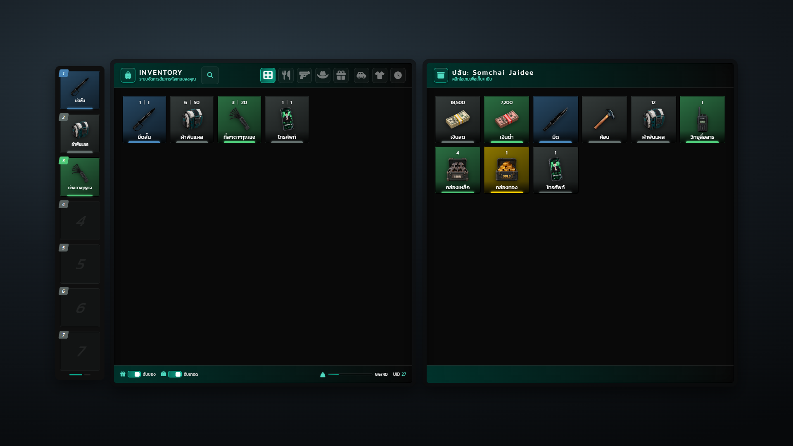
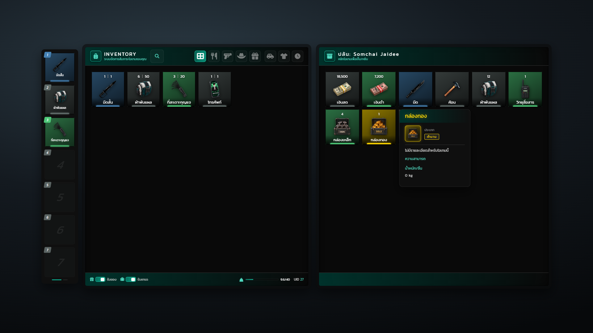
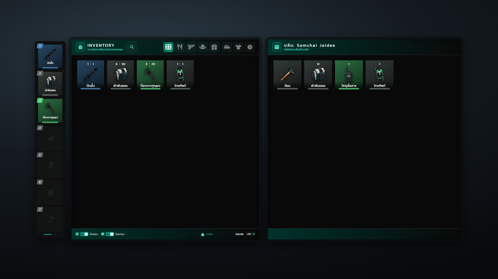
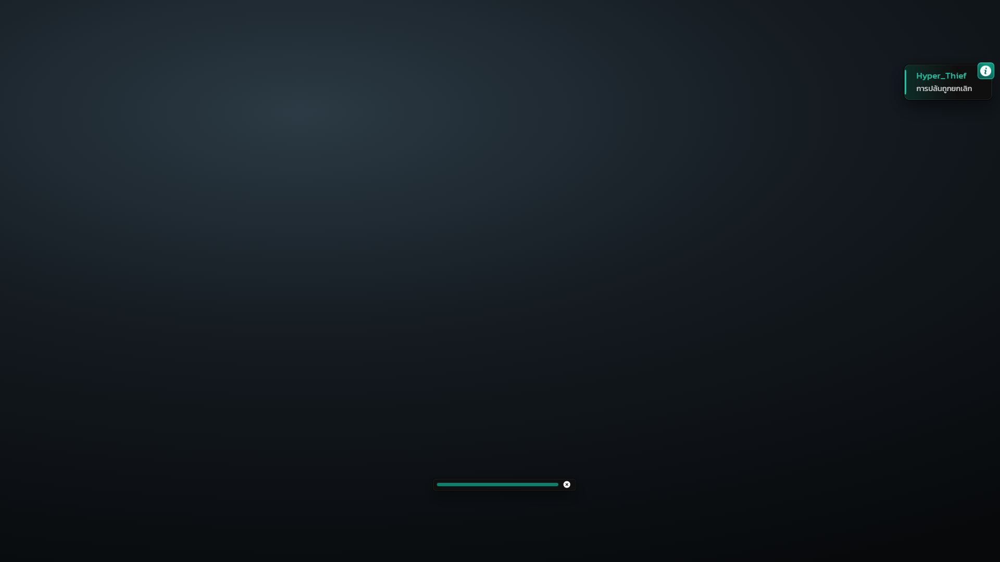
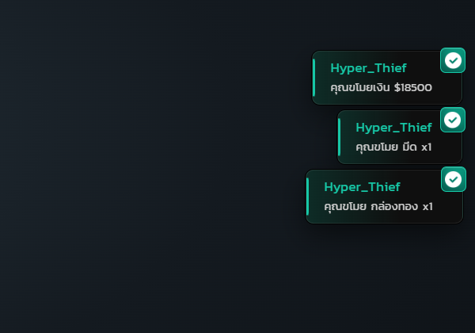
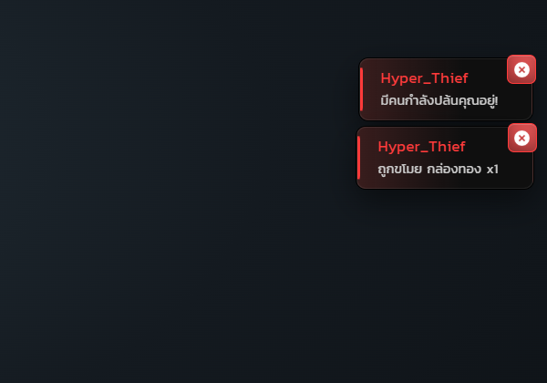
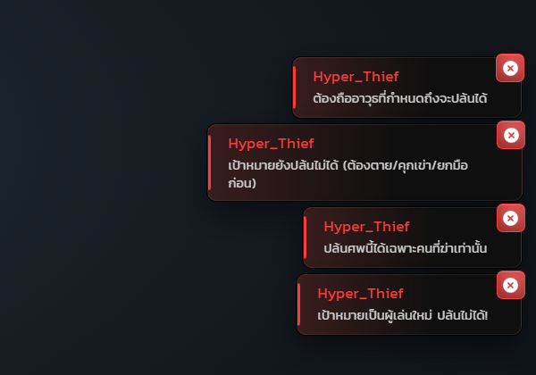

# หน้าจอ UI แต่ละโหมด

ภาพทั้ง 8 โหมดถ่ายจากโค้ด NUI จริงของ Hyper_Inventory และ Hyper_Notifyall โดยส่งข้อความแบบเดียวกับที่ Hyper_Thief สั่งในเกม ข้อมูลผู้เล่นและไอเทมในภาพเป็นข้อมูลจำลอง

## 1. หน้าต่างปล้น

ซ้ายคือกระเป๋าของผู้ปล้น ขวาคือตู้ "ปล้น: Somchai Jaidee" ที่สร้างจากกระเป๋าเหยื่อ มีทั้งเงินสด เงินดำ อาวุธ และไอเทม การ์ดแต่ละใบไล่สีตาม rarity

## 2. ดูรายละเอียดไอเทมของเหยื่อ

ชี้เมาส์ที่ "กล่องทอง" ในตู้เหยื่อแล้วการ์ดรายละเอียดขึ้น แสดงระดับ "ตำนาน" ก่อนตัดสินใจหยิบ

## 3. หลังล้วงของ

หยิบเงินสด เงินดำ มีด กล่องเหล็ก และกล่องทองไปแล้ว ตู้เหยื่อรีเฟรชทันทีผ่าน `RefreshStash` เหลือเฉพาะของที่ยังไม่ถูกเอาไป

## 4. หลอดโหลดก่อนปล้น

หลังกด G จะมีหลอด progressBar ของ Hyper_Notifyall วิ่ง 3.5 วินาทีกลางล่างจอ ระหว่างนั้นเดินหรือยิงไม่ได้

## 5. ยกเลิกการปล้น

กด X ระหว่างหลอดวิ่ง ไอคอนเปลี่ยนเป็นกากบาท และมุมขวาบนแจ้ง "การปล้นถูกยกเลิก"

## 6. แจ้งเตือนฝั่งผู้ปล้น

การ์ดสีเขียวยืนยันของที่ได้ทุกครั้ง เช่น เงิน $18500, มีด x1 และกล่องทอง x1

## 7. แจ้งเตือนฝั่งเหยื่อ

เหยื่อได้รับการ์ดสีแดงทันทีเมื่อเริ่มถูกปล้น และทุกครั้งที่ไอเทมถูกขโมย

## 8. ปล้นไม่ผ่านเงื่อนไข

ตัวอย่างข้อความปฏิเสธจาก server เช่น ไม่ถืออาวุธที่กำหนด เป้าหมายยังไม่ยกมือหรือคุกเข่า ไม่ใช่คนฆ่า และเป้าหมายมีไอเทมกันปล้น


ป้าย `[Rob]` เหนือหัว อนิเมชันยกมือ/คุกเข่า และ blip ตำรวจ วาดด้วย native ของเกม ไม่อยู่ในภาพชุดนี้

